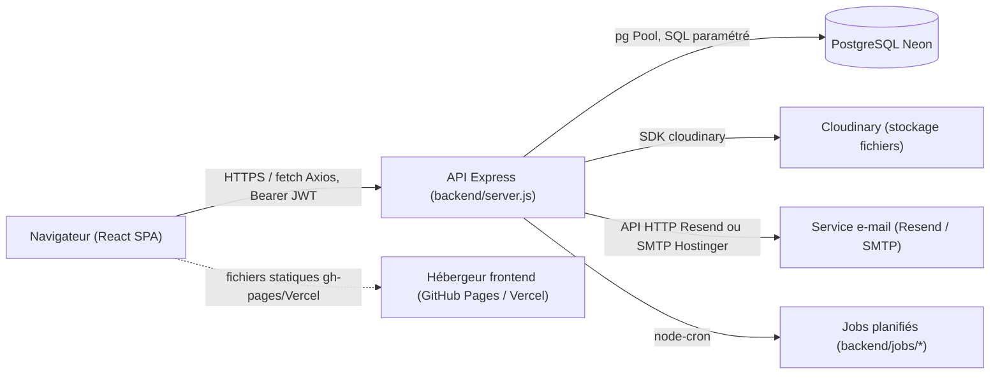

# 09 — Architecture technique

## Objectif
Donner à un développeur une vue d'ensemble fiable de l'architecture réelle du projet : organisation des dossiers, responsabilités, flux de communication, conventions.

## Périmètre
Architecture générale. Détails spécifiques dans les documents dédiés : [10_AUTHENTIFICATION.md](./10_AUTHENTIFICATION.md), [11_AUTORISATION_ET_PERMISSIONS.md](./11_AUTORISATION_ET_PERMISSIONS.md), [12_MODELE_DONNEES.md](./12_MODELE_DONNEES.md), [14_API_REST.md](./14_API_REST.md), [15_FRONTEND_ET_INTERFACE.md](./15_FRONTEND_ET_INTERFACE.md).

## 1. Vue d'ensemble

Voir aussi `documentsV2/diagrams/architecture-globale.mmd`.

## 2. Backend (`backend/`)

### 2.1 Point d'entrée
`backend/server.js` est le point d'entrée réel (déclaré `"main"` dans `backend/package.json` et lancé par `npm start` → `node server.js`). **À noter** : un fichier `backend/server_postgres.js` existe mais est **vide (0 ligne)** — c'est un résidu non fonctionnel, à ne pas confondre avec le serveur réel.

Au démarrage (`backend/server.js`), dans l'ordre :
1. Chargement de `dotenv`.
2. Connexion PostgreSQL (`backend/config/db_postgres.js`).
3. Exécution des migrations versionnées (`backend/migrations/runner.js`, pattern « baseline + migrations additives », voir §12).
4. Montage de ~48 routeurs Express sous des préfixes `/api/*` (liste complète en [14_API_REST.md](./14_API_REST.md)).
5. Démarrage de jobs planifiés : événements (`jobs/eventJobs.js`), sauvegarde quotidienne (`jobs/backupJob.js`, 02h00), vérification des traitements médicaux (`jobs/treatmentJob.js`), clôture automatique des présences (`jobs/attendanceJob.js`).

### 2.2 Organisation des dossiers
| Dossier | Rôle | Exemple |
|---|---|---|
| `routes_postgres/` | Définition des routes Express, validation `express-validator`, requêtes SQL directes pour la majorité des modules | `routes_postgres/attendance.js` |
| `controllers/` | Logique métier extraite pour certains modules plus complexes (traitements, tâches, RDV, fournitures, affectations, journal) | `controllers/treatmentsController.js` |
| `services/` | Logique réutilisable transverse (permissions, e-mails, Cloudinary, notifications, activité, paramètres) | `services/permissionsService.js` |
| `middleware/` | Authentification, autorisation, upload, journalisation, mise à jour de présence | `middleware/auth.js` |
| `migrations/` | Migrations versionnées (`versions/001...008`) + scripts SQL ponctuels historiques | `migrations/runner.js` |
| `emails/` | Service d'envoi + templates HTML + catalogue de types d'e-mails | `emails/emailService.js`, `emails/templates/` |
| `jobs/` | Tâches planifiées (`node-cron`) | `jobs/backupJob.js` |
| `utils/` | Fonctions utilitaires (réponses API, logger, jours fériés tunisiens, GeoIP) | `utils/logger.js` |
| `database/` | Schéma de référence historique (`schema_postgres.sql`, obsolète par endroits, voir §12) et rapports d'audit DB | `database/DB_AUDIT_REPORT.md` |
| `scripts/` | Scripts d'exploitation ponctuels (seed, nettoyage, migrations manuelles, diagnostics) — **non exécutés automatiquement** | `scripts/seed.js` |
| `tests/` | Tests Jest (middleware, utils, routes, un test d'inscription) | `tests/middleware/auth.test.js` |

Cette organisation correspond globalement au modèle en couches recommandé (routes / contrôleurs / services), mais de façon **partielle et hétérogène** : une majorité de modules (ex. `attendance.js`, `enrollments.js`) implémentent la logique et les requêtes SQL directement dans le fichier de route plutôt que dans un contrôleur séparé. Seuls quelques modules récents (`treatmentsController.js`, `tasksController.js`, `appointmentsController.js`, `dailyReportsController.js`, `enrollmentsController.js`, `staffAssignmentsController.js`, `suppliesController.js`, `activityLogController.js`) suivent la séparation route/contrôleur.

### 2.3 Accès base de données
`backend/config/db_postgres.js` configure un pool `pg` (non lu intégralement dans cet audit — **à vérifier** : paramètres exacts de pool, SSL). Les requêtes utilisent systématiquement des requêtes paramétrées (`$1, $2...`), ce qui limite le risque d'injection SQL (voir [20_SECURITE_ET_JOURNALISATION.md](./20_SECURITE_ET_JOURNALISATION.md)).

### 2.4 Middlewares globaux (`backend/server.js`)
Ordre de montage observé : `helmet` (CSP personnalisée) → `compression` → `morgan` (logs HTTP, format `combined` en prod / `dev` sinon) → **CORS** (liste blanche d'origines + callback dynamique) → **rate limiting** (`express-rate-limit`, 1000 req/15 min en prod, 10000 en dev) → parsing JSON/urlencoded (limite 10 Mo) → `activityLogger` (journalisation applicative, voir [20_SECURITE_ET_JOURNALISATION.md](./20_SECURITE_ET_JOURNALISATION.md)) → normalisation des doublons `/api/api/` → fichiers statiques (`/uploads`, `/public`) → routes `/api/*` → 404 → gestionnaire d'erreurs global.

### 2.5 Gestion des erreurs
Le gestionnaire d'erreurs global de `server.js` (lignes 423-461) distingue : erreurs de validation (`ValidationError` → 400), erreurs JWT (`JsonWebTokenError` → 401), erreurs CORS (message `'Non autorisé par CORS'` → 403), et erreur générique (500, message masqué en production). La plupart des routes gèrent cependant leurs propres erreurs via des blocs `try/catch` locaux renvoyant `{ success: false, error }`, ce qui explique une certaine hétérogénéité du format de réponse d'erreur d'un module à l'autre (`utils/apiResponse.js` propose un format standardisé mais n'est pas utilisé partout — **à vérifier module par module**, voir [23_ANOMALIES_ET_RECOMMANDATIONS.md](./23_ANOMALIES_ET_RECOMMANDATIONS.md)).

## 3. Frontend (`frontend/src/`)

### 3.1 Organisation
| Dossier | Rôle |
|---|---|
| `routes/AppRoutes.jsx` | Déclaration de toutes les routes React Router, avec lazy-loading (`React.lazy`) de chaque page et garde d'accès via `ProtectedRoute` |
| `layouts/` | `PublicLayout` (site public + Mon Espace) et `DashboardLayout` (tableau de bord) |
| `pages/` | Pages par domaine : `public/`, `auth/`, `parent/`, `staff/`, `dashboard/`, `messages/`, `tasks/`, `activities/`, `errors/` |
| `components/` | Composants réutilisables, également organisés par domaine (`attendance/`, `calendar/`, `modals/`, `ui/`, `mobile/`...) |
| `contexts/` | `AuthContext` (session), `SettingsContext`, `LanguageContext` (i18n/RTL), `DialogContext` |
| `access/` | Système de permissions frontend : `FEATURES.js` (registre des permissions), `useAccess.js` (hook), `Can.jsx` (composant conditionnel) |
| `services/` | Clients Axios par domaine (ex. `authService`), probablement un module central `services/api.js` (voir [15_FRONTEND_ET_INTERFACE.md](./15_FRONTEND_ET_INTERFACE.md)) |
| `hooks/` | Hooks personnalisés (ex. `useTheme.js`) |
| `i18n/` | Configuration `i18next` avec dictionnaires FR/AR en dur |
| `test/` | Tests Vitest + Testing Library |

### 3.2 Flux de rendu
`main.jsx` monte, dans l'ordre : `BrowserRouter` → `QueryClientProvider` (TanStack Query, `retry: 1`, `refetchOnWindowFocus: false`) → `AuthProvider` → `LanguageProvider` → `DialogProvider` → `App.jsx` (simple wrapper) → `AppRoutes.jsx` (`frontend/src/main.jsx` lignes 36-51). La bibliothèque CSS `flowbite`/`flowbite-datepicker` est importée globalement pour les composants de type datepicker.

### 3.3 Communication avec l'API
Le frontend appelle l'API via un client Axios centralisé `frontend/src/services/api.js` :
- **Base URL** : `API_CONFIG.BASE_URL` (`frontend/src/config/api.js`), timeout 30s par défaut (adapté au cold start du plan gratuit Render), porté à 5 minutes pour les uploads (détection `FormData`).
- **Authentification** : un intercepteur de requête lit `localStorage.getItem('token')` et ajoute l'en-tête `Authorization: Bearer <token>` sur chaque appel (lignes 14-34).
- **Gestion centralisée des erreurs** (intercepteur de réponse, lignes 52-125) :
  - `429` → message « Trop de requêtes » basé sur l'en-tête `retry-after` ;
  - `401` (hors `/auth/login`) → purge du token, redirection vers `/`, message « Session expirée » (pas de rafraîchissement de jeton, voir [10_AUTHENTIFICATION.md](./10_AUTHENTIFICATION.md)) ;
  - `403` → message contextualisé à partir de `required_roles` renvoyé par le backend, avec anti-spam (3 secondes entre deux dialogues identiques) ;
  - `5xx` et erreurs réseau → messages génériques via `dialogHelper`.
- **Cache applicatif** : `cachedGet()` fournit un cache hybride mémoire + `localStorage` (TTL par défaut 5 minutes, clé préfixée `creche_api_cache:`), avec repli sur la dernière valeur connue en cas de panne réseau (mode « stale »). Invalidable via `clearApiCache(prefix)`.
- **Uploads** : fonctions utilitaires génériques `uploadToEndpoint`, `uploadMultipleFiles` basées sur `FormData`.

### 3.4 Build et déploiement
Vite (`frontend/vite.config.js`) : proxy de dev vers `http://localhost:3003` pour `/api` et `/media`, découpage manuel des chunks (vendor/router/ui/forms/i18n), sourcemaps activées même en production. Déploiement : voir [19_TESTS_DEPLOIEMENT_MAINTENANCE.md](./19_TESTS_DEPLOIEMENT_MAINTENANCE.md).

## 4. Conventions observées
- **Langue du code** : commentaires et messages utilisateurs très majoritairement en français (y compris les messages d'erreur API), ce qui est cohérent avec le public cible.
- **Nommage des routes** : préfixe `/api/<domaine>`, un fichier de route par domaine dans `routes_postgres/`.
- **Validation** : `express-validator` (`body(...).isX()`) utilisé sur la plupart des routes de création/modification, mais pas systématiquement (plusieurs routes `PUT`/`PATCH` n'ont pas de validation déclarative explicite — à vérifier module par module).
- **Réponses JSON** : la forme `{ success: boolean, ...}` domine, mais certaines routes historiques (ex. `auth.js`) renvoient directement `{ error: '...' }` sans champ `success`, ou `{ message, token, user }` en cas de succès — **incohérence de contrat confirmée**, voir [23_ANOMALIES_ET_RECOMMANDATIONS.md](./23_ANOMALIES_ET_RECOMMANDATIONS.md).

## 5. Limites de cette analyse
- Le pool de connexions PostgreSQL (`backend/config/db_postgres.js`) n'a pas été audité en détail (taille de pool, gestion SSL stricte) — à vérifier si besoin d'un tuning de production.
- Le canal `i18next-http-backend` (chargement de traductions via `/locales/{{lng}}/{{ns}}.json`) est configuré mais aucun fichier correspondant n'a été localisé dans `frontend/public/` : à vérifier s'il s'agit d'un reliquat inutilisé.
