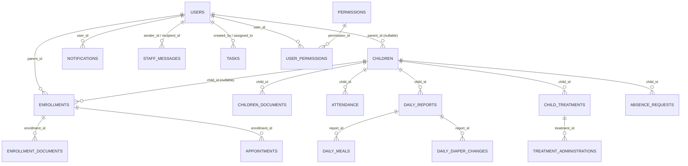

# 12 — Base de données et modèle de données

## Objectif
Décrire le schéma PostgreSQL réel, son mode d'évolution, les relations principales et les points de vigilance. Le détail champ par champ de chaque entité est dans [13_DICTIONNAIRE_DONNEES.md](./13_DICTIONNAIRE_DONNEES.md).

## 1. Comment le schéma est-il géré ? (important pour comprendre les sources)

Le projet a connu **plusieurs générations de gestion de schéma**, toutes visibles dans le dépôt :

1. **`backend/database/schema_postgres.sql`** : schéma de référence historique « from scratch » (DROP TABLE puis CREATE). Il ne contient que 6 tables (`users`, `children`, `enrollments`, `attendance`, `holidays`, `nursery_settings`) avec des colonnes aujourd'hui dépassées (ex. `role CHECK (role IN ('admin','staff','parent'))`, **sans `developer`**). **Ce fichier est obsolète et ne reflète plus l'état réel de la base** — confirmé par la contrainte `role` plus récente qui inclut `developer` (voir §2).
2. **`backend/migrations/versions/001_baseline_schema.js` à `008_...js`** : le système de migration **actuellement actif**, exécuté automatiquement au démarrage du serveur par `backend/migrations/runner.js` (appelé dans `server.js` ligne 44). C'est la **source la plus fiable** pour le schéma de base (21 tables dans la migration 001, plus des évolutions ciblées dans 002-008). Le runner utilise un pattern « baseline » : si la base existe déjà (cas de Neon en production), la migration 001 est enregistrée comme déjà appliquée sans ré-exécuter son DDL.
3. **Scripts SQL ponctuels** dans `backend/migrations/*.sql` (ex. `001_refactor_enrollments_workflow.sql`, `create_enrollment_documents_table.sql`, `add_enrollment_workflow_fields.sql`, `create_nursery_settings.sql`) et scripts Node ponctuels dans `backend/scripts/` (ex. `init_production_full.js`, `add-missing-tables.js`, `seed.js`) : ce sont des **opérations d'exploitation exécutées manuellement en production par le passé**, non rejouées automatiquement. Ils ont créé des tables qui n'apparaissent pas dans `migrations/versions/` (ex. `enrollment_documents`, `children_documents`, `announcements`, `tasks`, `activities`, `contact_messages`, `email_logs`, `personal_memos`, `logs`, `holiday_policies`).
4. **Tables créées à la demande par le code applicatif** (`CREATE TABLE IF NOT EXISTS` exécuté au premier appel d'un service), un pattern utilisé par `backend/services/permissionsService.js` (tables `permissions`, `user_permissions`) et `backend/controllers/treatmentsController.js` (tables `child_treatments`, `treatment_administrations`).

**Conséquence pour cet audit** : l'état réel de la base de production ne peut être garanti à 100 % sans accès direct à Neon. Le dictionnaire de données (§13) combine ces quatre sources et indique, pour chaque table, celle(s) qui la définissent. Le rapport `backend/database/DB_AUDIT_REPORT.md` (daté du 30 novembre, généré par un script d'introspection de l'équipe — `backend/scripts/db-audit.js` / `analyzeDatabase.js`) confirme un état à 28 tables à cette date, cohérent avec le périmètre listé ici, mais ne couvre pas les migrations 002-008 ultérieures (colonnes médicales, croissance, médias multiples des activités).

## 2. Rôles utilisateur (rappel)
`users.role` est contraint par `CHECK (role IN ('admin', 'staff', 'parent', 'developer'))` depuis la migration 001 (`backend/migrations/versions/001_baseline_schema.js` ligne 23). Voir [11_AUTORISATION_ET_PERMISSIONS.md](./11_AUTORISATION_ET_PERMISSIONS.md) pour la portée de chaque rôle.

## 3. Domaines fonctionnels et tables associées

| Domaine | Tables principales | Source(s) |
|---|---|---|
| Comptes & sécurité | `users`, `revoked_tokens`, `permissions`, `user_permissions` | migration 001 ; `permissionsService.js` |
| Enfants & familles | `children`, `child_growth_records` | migration 001, 002, 003, 004, 006 |
| Inscription (workflow) | `enrollments`, `enrollment_documents`, `children_documents`, `enrollments_archive`, `children_archive` | `001_refactor_enrollments_workflow.sql`, `create_enrollment_documents_table.sql`, migration 005 |
| Présences | `attendance` | migration 001 |
| Rendez-vous | `appointments` | migration 001 |
| Absences | `absence_requests` | migration 001 |
| Suivi quotidien | `daily_reports`, `daily_meals`, `daily_diaper_changes`, `child_supplies`, `daily_supplies_brought` | migration 001 |
| Traitements médicaux | `child_treatments`, `treatment_administrations` | `treatmentsController.js` (création à la demande) |
| Organisation interne | `staff_age_assignments`, `tasks`, `events`, `event_comments`, `event_history`, `event_reminders`, `holidays`, `holiday_policies`, `nursery_settings` | migration 001 ; `init_production.js`/`init_production_full.js` pour `tasks`, `event_*` |
| Communication | `notifications`, `staff_messages`, `announcements`, `personal_memos`, `contact_messages`, `email_logs` | migration 001 (`notifications`, `staff_messages`) ; scripts d'exploitation pour le reste |
| Activités / fil pédagogique | `activities`, `activity_comments`, `activity_reactions` | scripts d'exploitation ; migrations 007/008 (médias) |
| Direction / audit | `activity_logs`, `logs`, `testimonials`, `admin_documents`, `payment_reminders` | migration 001 (`activity_logs`, `testimonials`, `admin_documents`) ; scripts pour `logs`, `payment_reminders` |
| Tables jugées obsolètes (cf. audit interne) | `contacts`, `documents`, `uploads` | `backend/database/DB_AUDIT_REPORT.md` — recommandées à la suppression, **non supprimées** à ce jour |

## 4. Relations clés (vue d'ensemble)

Voir aussi `documentsV2/diagrams/modele-donnees.mmd` (version détaillée).

## 5. Points de vigilance confirmés dans le code

- **`enrollments` n'a plus `parent_id`/`child_id` obligatoires** depuis `001_refactor_enrollments_workflow.sql` : un dossier d'inscription naît avec des champs `applicant_*`/`child_*` autoportés (candidature d'un visiteur), et n'est rattaché à un `parent_id`/`child_id` réels qu'après approbation. C'est un changement de modèle important par rapport au schéma historique (`schema_postgres.sql`) qui imposait ces clés dès la création.
- **Relation parent-enfant redondante** : trois mécanismes coexistent pour savoir si un enfant appartient à un parent (`children.parent_id`, table `parent_children` référencée dans `middleware/auth.js`, et `enrollments.status = 'approved'`). La table `parent_children` elle-même n'a pas été localisée dans les scripts de création consultés — **à vérifier** si elle existe réellement en base ou si le code la requête de façon défensive sans qu'elle soit peuplée.
- **Colonnes marquées obsolètes mais encore présentes en base** selon `DB_AUDIT_REPORT.md` : `enrollments.appointment_date/appointment_time/parent_chose_rdv/parent_rdv_choice_date` (remplacées par la table `appointments`), plusieurs colonnes dénormalisées de `tasks` (`parent_name`, `parent_email`, `parent_phone`, `child_name`, `is_confirmed`, `confirmed_at`, `original_date`, `reschedule_count`). Un script de nettoyage est fourni dans ce même rapport mais **n'a pas été exécuté** (aucune trace d'exécution confirmée).
- **Tables dupliquées/obsolètes signalées par l'équipe elle-même** : `contacts` (doublon de `contact_messages`), `documents` et `uploads` (remplacés par Cloudinary + `enrollment_documents`/`children_documents`/`admin_documents`). Toujours présentes en base d'après le même rapport.
- **`second_parent_name`/`second_parent_phone`** ont été supprimées définitivement de `children` par la migration 004, au profit de `father_name`/`father_phone`/`mother_name`/`mother_phone` + `account_holder`.

## 6. Index et contraintes notables
- Contraintes d'unicité métier : `attendance(child_id, date)`, `enrollments(child_id)` (un enfant ne peut avoir qu'un seul dossier d'inscription actif dans le schéma baseline), `daily_reports(child_id, report_date)`, `child_supplies(child_id, supply_type)`, `staff_age_assignments(staff_id)`.
- Index orientés performance de lecture fréquente : `users(role)`, `users(last_active DESC)`, `children(parent_id)`, `enrollments(status)`, `attendance(child_id, date)`, `notifications(user_id, is_read)`, `revoked_tokens(token)`, `revoked_tokens(expires_at)`.
- Suppression en cascade (`ON DELETE CASCADE`) sur la quasi-totalité des clés étrangères pointant vers `children` et `users`, ce qui signifie qu'une suppression physique d'un enfant ou d'un utilisateur entraîne la perte définitive de tout son historique (présences, rapports, traitements, documents...). Aucune route de suppression physique d'un enfant n'a cependant été repérée côté API (la route `DELETE /api/children/:id` existe et est réservée à `admin`, voir [14_API_REST.md](./14_API_REST.md)) — à utiliser avec prudence.

## 6bis. Évolutions supplémentaires non tracées par un fichier de migration dédié
La lecture de `controllers/enrollmentsController.js` (fonction `approveEnrollment`) révèle que les tables `appointments` et `enrollments` portent, en production, des colonnes allant **au-delà** de la migration 001 et des scripts SQL recensés en §1 : `appointments.proposed_date`, `location`, `appointment_type`, `parent_email/phone/first_name/last_name`, `child_first_name/last_name`, `pending_response_from`, `last_proposed_by` ; `enrollments.processed_by`, `processed_at`, `active_appointment_id`, `created_parent_user_id`. Aucun fichier de migration versionné ou script SQL correspondant à ces colonnes n'a été localisé dans `backend/migrations/` : elles ont probablement été ajoutées directement en base de production (via une console SQL ou un script non conservé dans le dépôt). **Ceci confirme qu'une partie non négligeable du schéma réel échappe actuellement à toute trace reproductible dans le code versionné** — point majeur à signaler à l'équipe, voir [23_ANOMALIES_ET_RECOMMANDATIONS.md](./23_ANOMALIES_ET_RECOMMANDATIONS.md).

## 7. Limites et points à vérifier
- Existence réelle et structure de la table `parent_children` (référencée dans le code, non trouvée dans les scripts de création consultés).
- État exact des colonnes/tables obsolètes signalées par `DB_AUDIT_REPORT.md` au moment de la lecture de ce document (le nettoyage proposé n'ayant pas de preuve d'exécution).
- Paramètres de pool/SSL de `backend/config/db_postgres.js` (non audités en détail).
