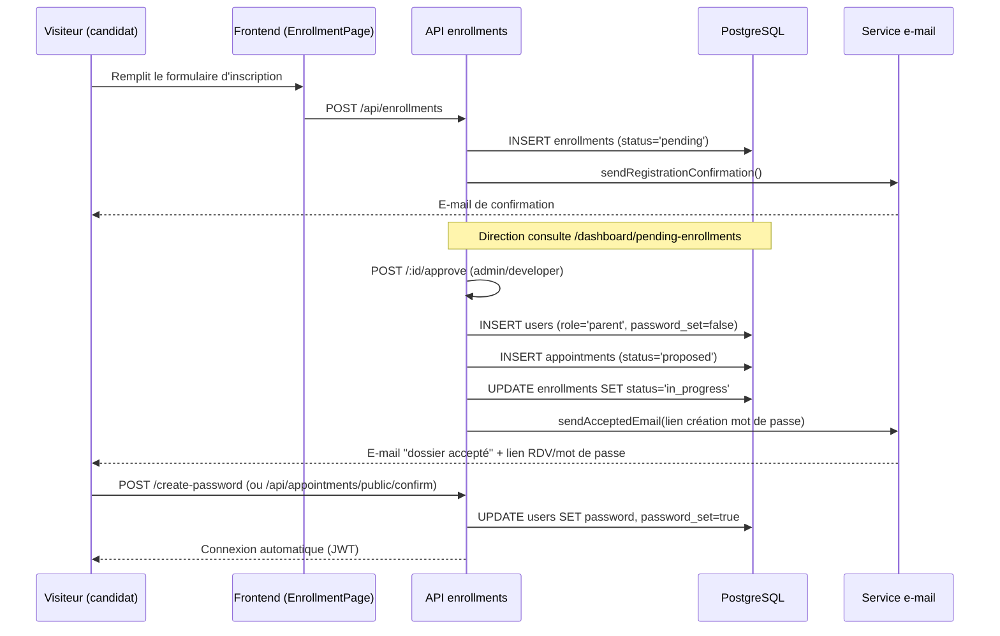

# 21 — Flux métier

## Objectif
Détailler, à partir du code, les principaux parcours métier de bout en bout. Chaque flux cite ses fichiers source.

## 1. Flux d'inscription d'un enfant (le plus complexe du système)

### Étapes détaillées
1. **Soumission** (`POST /api/enrollments`, public) : création d'un enregistrement `enrollments` à l'état `pending`, avec les champs `applicant_*` et `child_*` (aucun compte `users` ni fiche `children` n'existe encore). Vérifications de doublon disponibles en amont (`/check-child`, `/check-email`). E-mail `REGISTRATION_CONFIRMATION` envoyé (`emailService.sendRegistrationConfirmation`).
2. **Téléversement de documents** (`POST /:id/documents`) : stockage Cloudinary sous `enrollments/enrollment_{id}/` (`cloudinaryService.uploadEnrollmentDocument`), entrée `enrollment_documents`.
3. **Décision de la direction** (`controllers/enrollmentsController.js`) :
   - **Approbation** (`approveEnrollment`, `POST /:id/approve`, `admin`/`developer`) :
     a. Vérifie qu'aucun compte n'existe déjà avec l'e-mail du candidat (sinon 409, suggère d'utiliser « Ajouter un enfant »).
     b. Crée le compte `users` (`role='parent'`, mot de passe temporaire inutilisable, `password_set=false`, jeton `password_token` valable 7 jours).
     c. Crée un rendez-vous (`appointments`, `status='proposed'`, `pending_response_from='parent'`) à la date proposée par l'administrateur.
     d. Met à jour `enrollments.status='in_progress'`, lie `active_appointment_id` et `created_parent_user_id`.
     e. Envoie l'e-mail `ENROLLMENT_ACCEPTED` avec la date de RDV formatée et le lien `/create-password?token=...&email=...`.
     f. Les documents restent dans `enrollment_documents` ; leur transfert vers `children_documents` est différé à la finalisation (création effective de l'enfant), via `cloudinaryService.migrateEnrollmentToChild`.
   - **Documents manquants** (`sendMissingDocsEmail`) : e-mail `ENROLLMENT_MISSING_DOCS` avec lien `/upload-documents`.
   - **Rejet** (`rejectEnrollment`, `PUT /:id/reject`) : 4 motifs possibles (`age_depasse`, `maladie_contagieuse`, `dossier_manquant`, `places_completes`, `autre`), e-mail `ENROLLMENT_REJECTED`.
4. **Confirmation du rendez-vous par le parent** : via son espace (`PATCH /api/appointments/:id/confirm`) ou, s'il n'a pas encore de compte actif, via un lien public (`POST /api/appointments/public/confirm`). Le parent peut aussi proposer une autre date (`counter-propose`).
5. **Création du mot de passe** (`POST /api/auth/create-password`) : le parent définit son mot de passe définitif à partir du jeton reçu ; connexion automatique.
6. **Finalisation** (déduite du code, non entièrement auditée dans ce document) : après le rendez-vous honoré, une fiche `children` est créée/liée, les documents sont migrés Cloudinary (`enrollments/enrollment_{id}` → `children/child_{id}`), et le statut final de l'inscription est positionné (`approved`).

## 2. Flux de présence quotidienne
1. Le personnel ouvre `/dashboard/attendance` (vue du jour).
2. Pointe l'arrivée (`POST /api/attendance/check-in`, permission `attendance.manage`) → insertion/MAJ `attendance(child_id, date)`.
3. Pointe le départ (`POST /api/attendance/check-out`).
4. En fin de journée, le job `jobs/attendanceJob.js` clôture automatiquement les présences non clôturées manuellement (comportement exact non audité ligne à ligne — à vérifier : heure de fermeture issue de `nursery_settings`/`schedule-settings`).
5. Le parent consulte l'historique de présence de son enfant (`GET /api/attendance/child/:id/month`, page `AttendanceParentPage.jsx`).

## 3. Flux de bilan journalier
1. Le personnel habilité (`daily_reports.manage`) sélectionne un enfant du jour (`GET /api/daily-reports/children/today`).
2. Renseigne le bilan (repas via `daily_meals`, changes via `daily_diaper_changes`, sommeil, observations) → `POST /api/daily-reports`.
3. Statut `draft` → `completed` → `sent` (`PATCH /:id/status`).
4. Le parent consulte le bilan envoyé (`GET /api/daily-reports/parent/my-children`, `/:childId/history`).

## 4. Flux de traitement médical
1. Le parent déclare un traitement (`POST /api/treatments`) : médicament, dose, planning (intervalle ou heures précises), dates.
2. Le personnel habilité (`medical.treatments.manage`) consulte les traitements du jour (`GET /api/treatments/today`) et confirme chaque administration (`POST /:id/administer`) → insertion dans `treatment_administrations`.
3. Un job planifié (`jobs/treatmentJob.js`) vérifie les échéances et peut déclencher des notifications (mécanisme d'événements internes `treatmentEvents`, voir `controllers/treatmentsController.js`).
4. Le parent peut modifier/annuler le traitement tant qu'il est actif (`PUT /:id`, `DELETE /:id`).

## 5. Flux de déclaration d'absence
1. Parent → `POST /api/absence-requests` (dates, motif).
2. Personnel avec permission `absences.manage` → consultation (`GET /today`, `/all`) → traitement (`PUT /:id/acknowledge`).

## 6. Flux de réinitialisation de mot de passe
Voir [10_AUTHENTIFICATION.md](./10_AUTHENTIFICATION.md) §6 pour le détail technique complet.

## 7. Flux de publication d'une activité pédagogique
1. Personnel avec permission `activities.photos.publish` → `POST /api/activities` (texte + jusqu'à 10 fichiers média, 100 Mo max par fichier) → upload Cloudinary (`cloudinaryService.uploadFile`, `upload_large` pour les vidéos).
2. Publication visible sur `/activites` (réservée aux utilisateurs connectés depuis la correction du 11/10/2026, voir [07_CATALOGUE_FONCTIONNALITES.md](./07_CATALOGUE_FONCTIONNALITES.md)) et `/mon-espace/activities`/`/dashboard/activities`.
3. Réactions et commentaires ouverts à tout utilisateur authentifié.

## 8. Limites et points à vérifier
- Étape exacte de « finalisation » de l'inscription (création définitive de la fiche `children` à partir des champs `enrollments.child_*`) : fonction non identifiée avec certitude dans `enrollmentsController.js` au-delà de `approveEnrollment`/`rejectEnrollment` — probablement déclenchée à la confirmation du rendez-vous (`appointmentsController.confirmAppointment`, mentionné en commentaire ligne 358 de `enrollmentsController.js`) ; non auditée en détail.
- Comportement exact du job de clôture automatique des présences (`attendanceJob.js`).
- Mécanisme précis de déclenchement des rappels de traitement (`treatmentEvents`).
